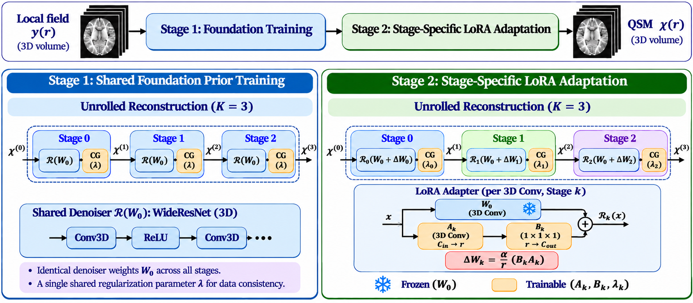

# LoRA-QSM: A Two-Stage Learning Paradigm for Model-Based QSM Reconstruction

[](https://www.python.org/downloads/)
[](https://pytorch.org/)

Official code repository for:
**"A Two-Stage Learning Paradigm for Model-Based QSM Reconstruction: From Shared Foundation Priors to Stage-Specific LoRA Adaptation"**  
*Venkatesh Vaddadi and Phaneendra K. Yalavarthy*  
*Medical Imaging Group (MIG), Department of Computational and Data Sciences, Indian Institute of Science (IISc), Bangalore, India.*

---

## 📌 Method Overview

Model-based deep learning (MoDL) unrolls regularized dipole inversion into alternating denoising and data-consistency steps. However, existing unrolled physics networks face a trade-off:
- **Weight-Shared Networks**: Enforce identical denoiser weights across all iterations, sacrificing stage specialization despite evolving artifact distributions.
- **Fully Unshared Networks**: Train independent deep backbones per stage, leading to a $K$-fold parameter explosion and higher risk of overfitting or representation drift.

**LoRA-QSM** resolves this challenge using a **Two-Stage Learning Paradigm**:
1. **Stage 1 (Foundation Prior)**: Trains a 3D CNN denoiser with shared weights $\mathbf{W}_0$ and a single regularizer $\lambda$ across all unrolling iterations.
2. **Stage 2 (Stage-Specific Adaptation)**: The foundation backbone is frozen ($\nabla_{\mathbf{W}_0}\mathcal{L} = \mathbf{0}$). Lightweight 3D Low-Rank Adaptation (LoRA) modules ($\Delta \mathbf{W}_k = \frac{\alpha}{r}\mathbf{B}_k \star \mathbf{A}_k$) and stage-wise regularizers $\lambda_k$ are attached to each unrolled step via forward hooks.

<p align="center">
  
</p>

---

## 📂 Experiments & Code Mapping

| Experiment / Task | Implementation Script / Module |
| :--- | :--- |
| **Framework Architecture Pipeline** | `figures_generation/fig1_two_stage_qsm_paradigm.png` |
| **Parameter Footprint Complexity ($K=3$)** | `qsm_modules/qsm_dw_models/WideResnet.py` |
| **Source SNU In-Domain LoRA Training & Evaluation** | `stage2_lora_adaptation/train_shared_spinet_with_stage_lora.py`<br>`stage2_lora_adaptation/test_checkpoint.py` |
| **Zero-Shot Cross-Domain Evaluation (32 LPCNN Volumes)** | `cross_domain_lpcnn/eval_lpcnn_models.py` |
| **Single-Subject Calibration & Holdout Testing (Subjects 5–8)** | `cross_domain_lpcnn/train_target_adapt_lpcnn_p2_val_p4.py`<br>`cross_domain_lpcnn/eval_lpcnn_alpha16.py` |
| **Full Shared & Unshared Fine-Tuning Baselines** | `cross_domain_lpcnn/baselines/train_target_adapt_shared_base.py`<br>`cross_domain_lpcnn/baselines/train_target_adapt_unshared_isdu.py` |
| **GPU Memory, Optimizer States, and Inference Latency Profiling** | `benchmarks_and_profiling/profile_all_memory.py` |
| **LPCNN Holdout Reconstructions & Error Difference Maps** | `figures_generation/generate_figure3_lpcnn.py` |
| **Validation Convergence & Stage-Wise $\lambda_k$ Evolution Plotting** | `figures_generation/plot_figure4.py` |

---

## 💻 Installation

Clone this repository and install dependencies:
```bash
git clone https://github.com/venkateshvaddadi/LoRA-QSM.git
cd LoRA-QSM
pip install -r requirements.txt
```

---

## 🏃 Quick Start & Execution

### 1. Stage 1: Shared Foundation Model Pre-training
Train the shared foundation backbone across all $K=3$ iterations:
```bash
python stage1_foundation/train_stage1_shared_foundation.py
```

### 2. Stage 2: Stage-Specific In-Domain LoRA Adaptation
Freeze the foundation weights and train stage-specific low-rank adapters on the SNU benchmark:
```bash
# Rank 4, Alpha 8.0 (Table II)
python stage2_lora_adaptation/train_shared_spinet_with_stage_lora.py

# High-gain coupling (Alpha 16.0)
python stage2_lora_adaptation/train_lora_r4_alpha16.py
python stage2_lora_adaptation/train_lora_r8_alpha16.py
```

### 3. Cross-Domain Zero-Shot Evaluation (Table III)
Evaluate models directly on the 7T multi-orientation LPCNN benchmark:
```bash
python cross_domain_lpcnn/eval_lpcnn_models.py
```

### 4. Single-Subject Target Domain Calibration (Table IV)
Calibrate lightweight adapters on patches from a single target subject (e.g., Subject 2) with Subject 4 validation:
```bash
python cross_domain_lpcnn/train_target_adapt_lpcnn_p2_val_p4.py
```
Evaluate generalization across holdout Subjects 5, 6, 7, and 8:
```bash
python cross_domain_lpcnn/eval_lpcnn_alpha16.py
```

### 5. Memory Profiling & Inference Latency Benchmarks
Profile GPU memory allocation, optimizer states, and inference latency on 3D volumes:
```bash
python benchmarks_and_profiling/profile_all_memory.py
```
